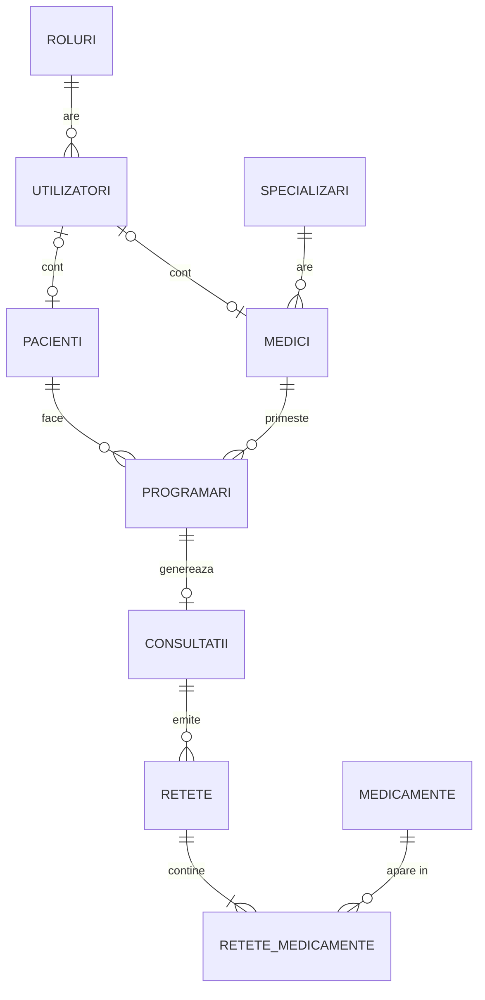

# Clinică medicală — proiect Baze de date avansate

Aplicație web de management pentru o clinică medicală: pacienți, medici, programări, consultații și rețete.
Tehnologii: **PostgreSQL** (găzduit pe Neon), **Python + Flask**, SQL scris direct (fără ORM), Bootstrap.

## Etape

| Etapa | Ce conține | Documentație |
|---|---|---|
| 1. Modelare | 10 tabele, relații 1:1, 1:N, N:M, constrângeri, fixtures | [docs/etapa1_modelare.md](docs/etapa1_modelare.md) |
| 2. CRUD | CRUD pe 8 tabele, descrierea paginilor | [docs/etapa2_crud.md](docs/etapa2_crud.md) |
| 3. Autentificare | login, 4 roluri, parole bcrypt verificate în PostgreSQL | [docs/etapa3_autentificare.md](docs/etapa3_autentificare.md) |

## Structura proiectului

```
app.py                 pornirea aplicației, pagina principală
db.py                  conexiunea la PostgreSQL + funcțiile query / execute / transaction
auth.py                login, logout, roluri, administrarea conturilor
routes/                paginile CRUD (pacienti, medici, nomenclatoare, programari, consultatii)
templates/             paginile HTML (Jinja2 + Bootstrap)
sql/01_schema.sql      etapa 1: tabelele
sql/02_seed.sql        etapa 1: datele de test
sql/03_autentificare.sql  etapa 3: parole, funcția autentifica()
genereaza_fixtures.py  generatorul datelor de test
docs/                  documentația fiecărei etape
```

## Pornire (Windows / PowerShell)

**1. Baza de date.** Ultimul fișier se rulează o singură dată pe Neon. Primele două sunt deja încărcate.

```powershell
& "C:\Program Files\PostgreSQL\16\bin\psql.exe" -h pg.neon.tech
```
```sql
\encoding UTF8
\i sql/03_autentificare.sql
```
Pe o bază de date nouă rulezi toate trei, în ordine: `01_schema.sql`, `02_seed.sql`, `03_autentificare.sql`.

**2. Aplicația**
```powershell
cd clinica-app
python -m venv .venv
.venv\Scripts\activate
pip install -r requirements.txt
copy .env.example .env      # apoi pune connection string-ul din Neon în .env
python app.py
```
Deschide **http://127.0.0.1:5000**.

## Conturi demo (parola `Parola123!`)

| Rol | Email |
|---|---|
| admin | `admin@clinica.ro` |
| receptioner | `receptie1@clinica.ro` |
| medic | `dr.adrian.ionescu@clinica.ro` |
| pacient | `radu.dragomir1@exemplu.ro` |

## Diagrama ERD


