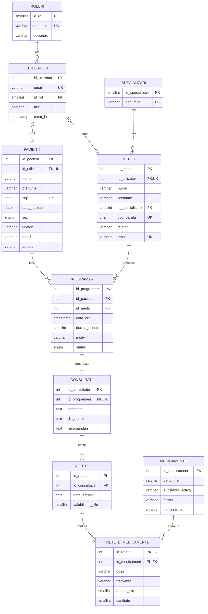

# Clinică medicală — proiect Baze de date avansate

Aplicație de management pentru o clinică medicală: pacienți, medici, programări, consultații și rețete. Baza de date: PostgreSQL (găzduită pe Neon).

## Etapa 1 — Modelare

**Cerință:** minimum 6 tabele, relații, fixtures. **Realizat:** 10 tabele, 11 relații, date de test generate automat.

## Fișiere

| Fișier | Conținut |
|---|---|
| `01_schema.sql` | Schema PostgreSQL: tabele, PK, FK, UNIQUE, CHECK, ENUM |
| `02_seed.sql` | Fixtures (date de test) gata de rulat |
| `genereaza_fixtures.py` | Scriptul care generează `02_seed.sql` (parametrizabil — util la load test în etapa 4) |
| `README.md` | Documentația + diagrama ERD (mai jos) |

## Rulare

```bash
# (opțional) regenerează datele de test
python genereaza_fixtures.py

# încarcă schema și datele
psql -d clinica -f 01_schema.sql
psql -d clinica -f 02_seed.sql
```

Sau din `psql`: `\encoding UTF8`, apoi `\i 01_schema.sql` și `\i 02_seed.sql`.

Baza de date e încărcată și în Neon: proiectul `clinica-bda`, baza `clinica`.

Pentru mai multe date: `python3 genereaza_fixtures.py --pacienti 5000 --programari 20000`

## Diagrama ERD



## Tabele

| # | Tabel | Rol | Înregistrări în fixtures |
|---|---|---|---|
| 1 | `roluri` | admin, medic, receptioner, pacient | 4 |
| 2 | `utilizatori` | conturile aplicației (email, rol, activ) | 51 |
| 3 | `specializari` | nomenclator specializări medicale | 10 |
| 4 | `medici` | datele medicilor, cod parafă unic | 13 |
| 5 | `pacienti` | datele pacienților, CNP unic și valid | 60 |
| 6 | `programari` | programări pacient–medic, cu status | 300 |
| 7 | `consultatii` | istoric medical (simptome, diagnostic, recomandări) | 202 |
| 8 | `medicamente` | nomenclator medicamente | 28 |
| 9 | `retete` | rețete emise la consultație | 161 |
| 10 | `retete_medicamente` | tabel asociativ rețetă ↔ medicament (doză, frecvență) | 231 |

## Relații

| Relație | Tip | Implementare |
|---|---|---|
| Roluri → Utilizatori | 1:N | `utilizatori.id_rol` FK |
| Utilizatori → Medici | 1:1 (opțional) | `medici.id_utilizator` FK + UNIQUE |
| Utilizatori → Pacienți | 1:1 (opțional) | `pacienti.id_utilizator` FK + UNIQUE |
| Specializări → Medici | 1:N | `medici.id_specializare` FK |
| Pacienți → Programări | 1:N | `programari.id_pacient` FK |
| Medici → Programări | 1:N | `programari.id_medic` FK |
| Pacienți ↔ Medici | N:M | prin `programari` |
| Programări → Consultații | 1:1 | `consultatii.id_programare` FK + UNIQUE |
| Consultații → Rețete | 1:N | `retete.id_consultatie` FK |
| Rețete ↔ Medicamente | N:M | tabel asociativ `retete_medicamente` (PK compus) |

## Constrângeri de integritate

- **CNP**: 13 cifre, prima cifră 1–8 (`CHECK` cu regex); fixtures-urile au cifra de control calculată corect.
- **Cod parafă**: 6 caractere alfanumerice, unic.
- **Email**: format valid, unic pentru utilizatori și medici.
- **Programări**: un medic nu poate avea două programări la aceeași oră (`UNIQUE (id_medic, data_ora)`); durata între 10 și 180 min.
- **Status programare**: `ENUM ('programat', 'anulat', 'finalizat')`.
- **Rețete**: valabilitate 1–365 zile; cantitate > 0.
- **Ștergeri**:
  - `CASCADE` acolo unde datele copil nu au sens singure (programare → consultație → rețetă);
  - `RESTRICT` pe nomenclatoare și pe medici, ca să nu se piardă istoricul;
  - `SET NULL` pe contul de utilizator.

## Normalizare (3NF)

- Specializările și medicamentele sunt nomenclatoare separate, ca să nu se repete textul.
- Medicamentele de pe rețetă stau în tabelul asociativ, nu ca text liber.
- Datele de login (`utilizatori`) sunt separate de datele de profil (`medici` / `pacienti`).

## Fixtures — consistența datelor

- Programările acoperă ultimele 6 luni și următoarele 6 săptămâni, doar în zile lucrătoare, între 08:00 și 16:00, în sloturi de 30 de minute.
- Statusuri: cele din trecut sunt `finalizat` sau `anulat`, cele din viitor sunt `programat` sau `anulat`.
- Consultațiile există doar pentru programările finalizate. Diagnosticul, simptomele și medicamentele prescrise sunt coerente între ele.
- Generatorul pornește de la un seed fix (`--seed 42`), deci produce de fiecare dată aceleași date.

## Ce NU e inclus (vine în etapele următoare)

- Parolele și autentificarea: etapa 3.
- Indecșii de performanță și load testul: etapa 4.
